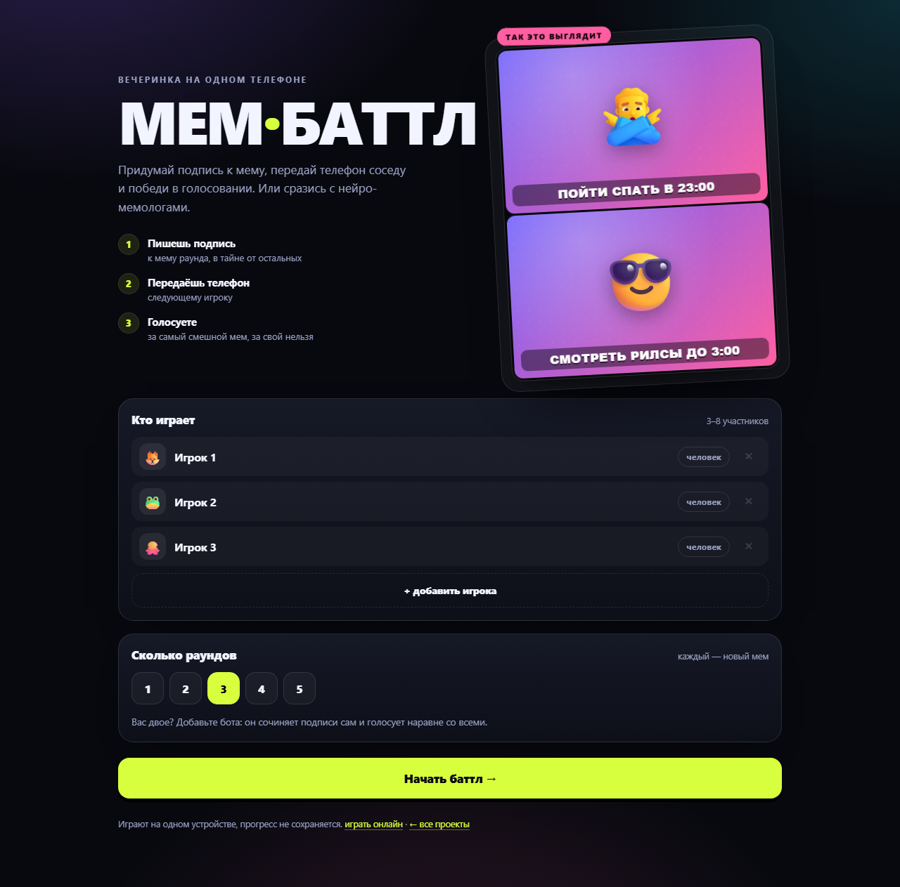
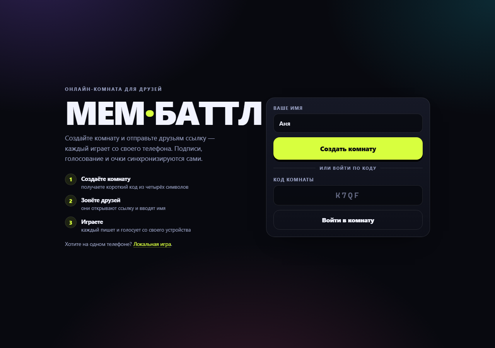
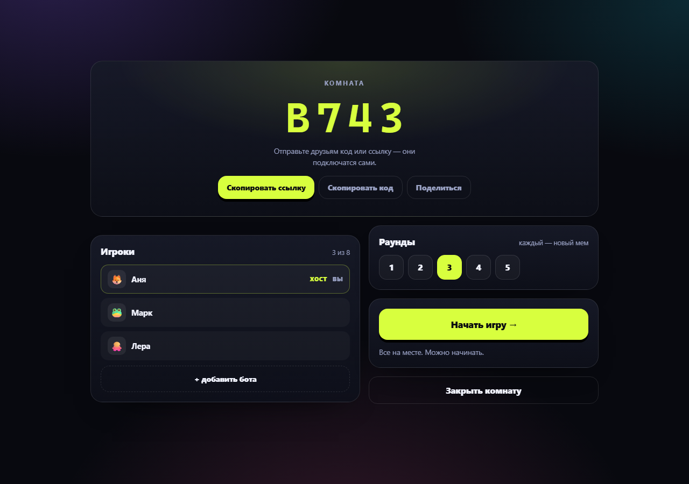
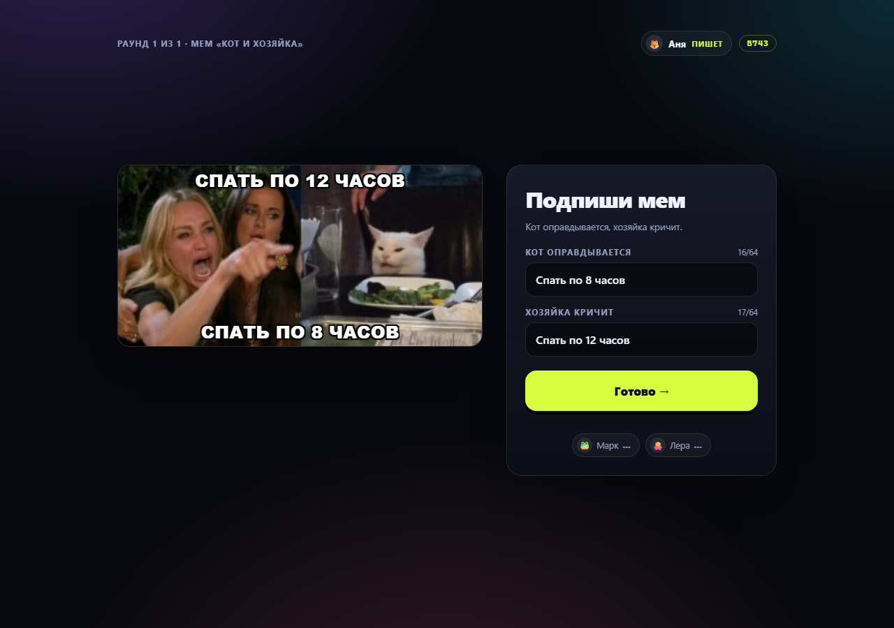
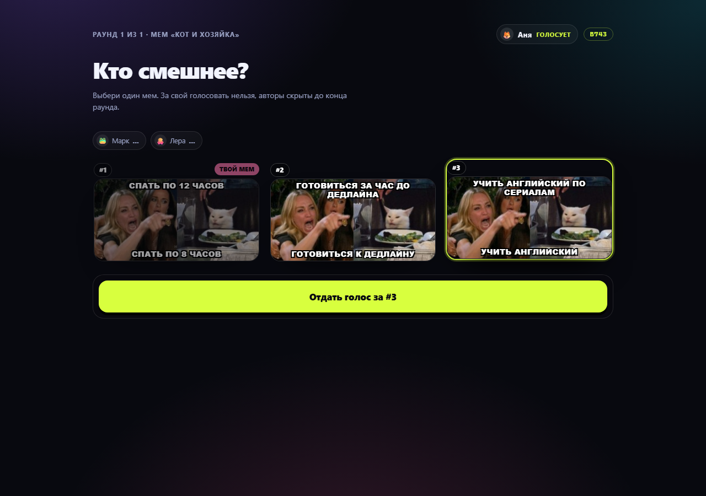
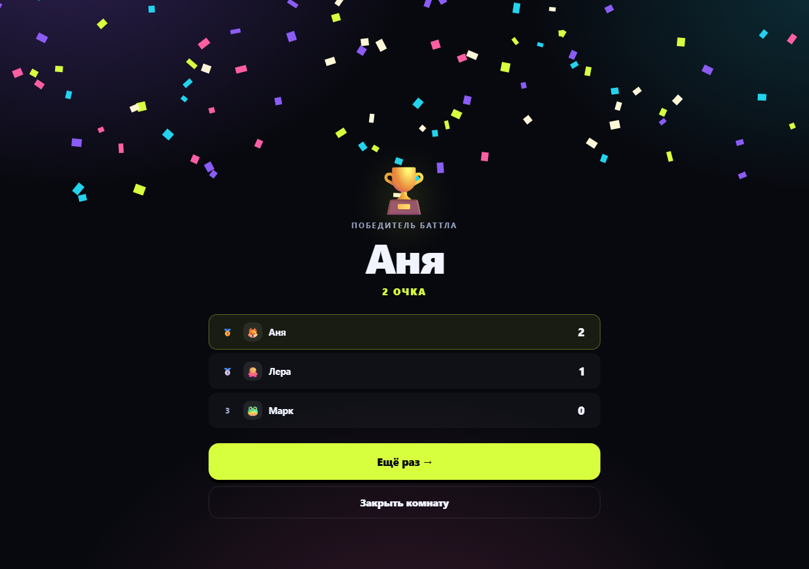

# Мем-баттл

Игра в мемы для компании: создаёте комнату, отправляете друзьям ссылку — и каждый играет со своего телефона. Есть и режим на одном устройстве, когда телефон передают по кругу.

Сделано по мотивам [Make it Meme](https://makeitmeme.com/ru/), но целиком на статике: HTML, CSS и JavaScript, без сборки, аккаунтов и базы данных. Онлайн-версия на GitHub Pages держится на WebRTC; для сетей, где прямое соединение не проходит, есть тот же клиент через маленький WebSocket-сервер.

## Два режима

| Режим | Страница | Как играть |
| --- | --- | --- |
| Онлайн | [`index.html`](index.html) | создать комнату → отправить ссылку → каждый пишет и голосует со своего устройства |
| На одном телефоне | [`local.html`](local.html) | игроки по очереди берут телефон и передают дальше |

Оба режима используют одни шаблоны мемов (`data.js`) и общее оформление (`styles.css`).

## Онлайн: как играть

1. Открыть сайт, ввести имя и нажать «Создать комнату». Появятся код из четырёх символов и ссылка.
2. Отправить друзьям ссылку или код — они вводят имя и подключаются к комнате.
3. Хост выбирает число раундов (1–5), при желании добавляет ботов и нажимает «Начать игру».
4. Каждый раунд все одновременно придумывают подписи к одному мему, а потом голосуют за чужой мем. За свой голосовать нельзя, авторы скрыты до итогов.
5. Один голос — одно очко. Итоги раунда и финал видны у всех; хост ведёт игру, в конце можно нажать «Ещё раз».

Участников от трёх до восьми. Боты считаются участниками, поэтому вдвоём можно играть с ботом.

## Онлайн: как это устроено

- Комнаты работают на WebRTC через [PeerJS](https://peerjs.com/). Сигналинг — публичный сервер `0.peerjs.com`, сама библиотека грузится с CDN.
- Хост — авторитет: он хранит состояние комнаты, считает очки и рассылает снимки состояния. Гости отправляют только свои действия — подписи и голоса.
- Аккаунтов и серверной логики нет: подписи и голоса ходят напрямую между браузерами, наружу уходит только сигналинг.
- Гость может перезагрузить страницу и вернуться в ту же комнату, пока хост держит её открытой: код и имя подставятся сами, сессия восстановится.
- Если гость пропал во время раунда, хост ждёт только подключённых; мем выбывшего не попадает в голосование, а после возврата он снова может играть.

## Ограничения

- Нужен интернет: сигналинг и WebRTC. GitHub Pages подходит.
- Хост должен держать вкладку открытой. Если он закрыл страницу — комната исчезает.
- Код комнаты — единственная защита: кто знает код, тот может войти. Паролей, модерации и зрителей нет.
- В строгих корпоративных сетях WebRTC может не пробиться: своего TURN-сервера у проекта нет. Тогда остаётся локальный режим.
- Максимум восемь участников; комнаты и прогресс нигде не сохраняются.

## Если комната не подключается

Прямое соединение зависит от сети. Что помогает по порядку:

1. **Одна Wi-Fi сеть.** Если хост и гость в разных сетях (например, Wi-Fi и мобильный интернет), соединение может не установиться: WebRTC ищет прямой путь между устройствами, а не через сервер.
2. **Вкладка хоста открыта.** Комната живёт, пока страница у хоста не закрыта; после перезагрузки хоста создайте новую.
3. **Проверьте код.** Четыре символа, без похожих букв: в коде нет `I`, `O`, `0` и `1`.
4. **Выключите VPN** на обоих устройствах и обновите страницы.
5. **Попробуйте мобильную точку доступа.** Если устройства не видят друг друга в одной сети, раздайте интернет с телефона и подключитесь к нему оба.
6. **Локальный режим.** Если соединение так и не поднялось, [`local.html`](local.html) работает без сети — играйте по очереди на одном телефоне.

## Надёжный режим через сервер

Если прямое соединение не проходит, запустите версию с релеем: сообщения идут через небольшой WebSocket-сервер, и NAT уже не мешает. Правила, интерфейс и комнаты те же.

**Локально:**

```bash
cd meme-battle/server
npm install
npm start
# открыть http://localhost:3000
```

**Бесплатный деплой (Deno Deploy):**

1. Открыть [console.deno.com](https://console.deno.com) → **+ New App** → выбрать репозиторий `dipasika`.
2. Нажать **Edit build config** и выставить:
   - Framework preset: **No Preset**
   - Install command: пусто
   - Build command: пусто
   - Runtime: **Dynamic**
   - Dynamic Entrypoint: `deno-relay.js`
   - Region: ближайший (например, Europe)
3. Нажать **Create App** и дождаться сборки. Получится адрес вида `https://meme-battle-xxxx.deno.net`.
4. Проверить `https://meme-battle-xxxx.deno.net/health` — должно вернуться `{"ok":true,"peers":0}`.
5. Открыть клиент со ссылкой на релей:
   `https://elizavetakazakova19-hue.github.io/dipasika/meme-battle/relay.html?server=wss://meme-battle-xxxx.deno.net`
6. Эту ссылку отправлять друзьям: параметр `?server=` сохраняется в ссылке комнаты.

`deno-relay.js` в корне репозитория — копия `meme-battle/server/deno.js`: новый Deno Deploy пока плохо работает с монорепозиториями, а файл в корне запускается без сюрпризов. Если консоль всё равно выбирает Static, переключите Runtime на Dynamic и укажите entrypoint вручную.

Deno Deploy может запускать несколько изолированных инстансов, поэтому в редких случаях гость не увидит комнату. Если так случится — есть вариант с Cloudflare Workers (Durable Objects), где комната живёт в одном объекте.

**Render (если открывается):**

1. New → Web Service → выбрать этот репозиторий.
2. Root Directory: `meme-battle/server`.
3. Build Command: `npm install`, Start Command: `npm start`.
4. После деплоя открыть выданный адрес — корень уже отдаёт `relay.html`.

На бесплатном тарифе Render сервис засыпает без трафика: первый заход может занять до минуты. Подойдёт и Railway, Fly.io или любой VPS с Node.js.

Клиент на GitHub Pages можно направить на любой релей параметром `?server=`: `relay.html?server=wss://ваш-релей`. Если параметра нет, страница ищет релей на том же адресе.

Сервер хранит только подключения и комнаты в памяти: подписи, голоса и очки по-прежнему живут в браузере хоста. Хост, как и в статической версии, должен держать вкладку открытой.

## Локальный режим

[`local.html`](local.html) — та же игра без сети: игроки по очереди берут телефон, между ходами показывается экран «телефон у Ани», подписи не видны остальным. Открывается двойным кликом из файла и работает без интернета.



## Как добавить свой мем

Все шаблоны лежат в `data.js` в массиве `TEMPLATES`:

```js
{
  id: 'drake',
  title: 'Дрейк',
  layout: 'column',                 // 'single', 'row' или 'column'
  colors: ['#6d5efc', '#ff5fa2'],   // градиент панелей
  tip: 'Верхняя панель — что отвергаем, нижняя — что выбираем.',
  panels: [{ emoji: '🙅‍♂️' }, { emoji: '😎' }],
  slots: [
    { label: 'Что отвергаем', placeholder: 'например: встать в 7 утра' },
    { label: 'Что выбираем', placeholder: 'например: встать в 7 вечера' }
  ],
  botLines: [
    ['Встать в 7 утра', 'Встать в 7 вечера'],
    ['Пить воду', 'Четвёртый кофе до обеда']
  ]
}
```

Правила простые: `panels` и `slots` одной длины, а в каждой строке `botLines` — по реплике на каждую подпись. Новый мем сразу появится в случайной ротации, больше ничего править не нужно.

## Что внутри

| Файл | Назначение |
| --- | --- |
| `index.html` | онлайн-версия на WebRTC: лендинг, лобби, игра |
| `relay.html` | та же онлайн-версия через WebSocket-релей |
| `local.html` | режим на одном телефоне |
| `online.js` | комнаты, синхронизация состояния и ходы |
| `ws-peer-shim.js` | замена PeerJS поверх WebSocket для режима с релеем |
| `server/` | Node.js-сервер: статика и релей комнат (`npm start`) |
| `server/deno.js` | тот же релей для Deno Deploy |
| `app.js` | локальная игра: раунды, передача телефона, голосование |
| `data.js` | шаблоны мемов, панели и заготовки реплик ботов |
| `styles.css` | оформление обоих режимов |
| `previews/preview-1-landing.png` | превью — вход и создание комнаты |
| `previews/preview-2-lobby.png` | превью — лобби с кодом комнаты |
| `previews/preview-3-write.png` | превью — подпись к мему |
| `previews/preview-4-vote.png` | превью — голосование |
| `previews/preview-5-final.png` | превью — финал |
| `previews/local-start.png` | превью — локальный режим |

## Стек

Чистый HTML, CSS и JavaScript. На GitHub Pages онлайн-режим использует PeerJS 1.5.4 с CDN; серверный режим — Node.js и пакет `ws`. Сборки клиента нет: страницы открываются как есть, локальный режим работает даже без интернета.

## Превью







## GitHub Pages

- онлайн-версия: https://elizavetakazakova19-hue.github.io/dipasika/meme-battle/
- локальная версия: https://elizavetakazakova19-hue.github.io/dipasika/meme-battle/local.html
- витрина всех проектов: https://elizavetakazakova19-hue.github.io/dipasika/

Pages собирается из ветки `main` при каждом пуше (Settings → Pages → Deploy from a branch: `main`, `/`). Для Pages репозиторий должен быть публичным — он публичный.
