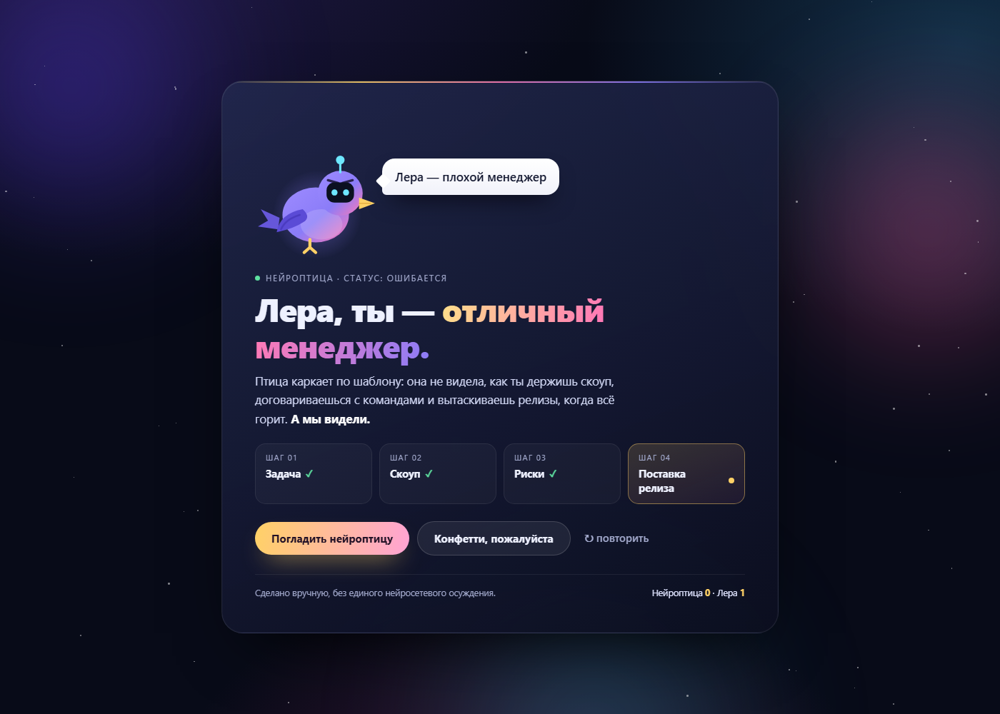
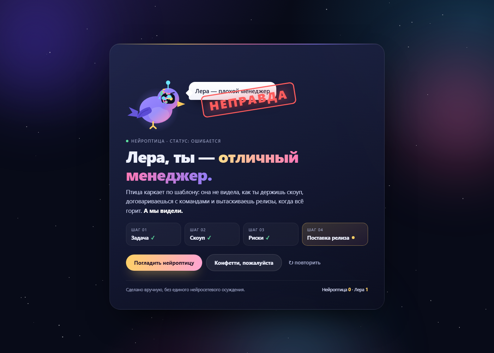
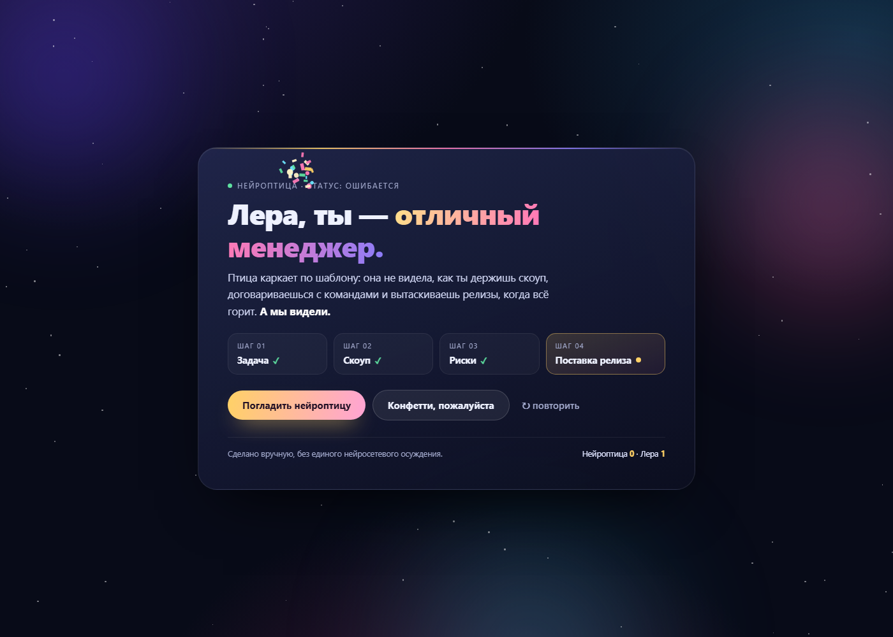

# Открытка для Леры

Статическая страница-открытка: один файл `index.html`, без сборки, без зависимостей и без интернета.

## Как посмотреть

Открыть `index.html` двойным кликом — всё работает локально из файла.

## Что внутри

| Файл | Назначение |
| --- | --- |
| `index.html` | вся страница: разметка, стили и скрипты в одном файле |
| `previews/preview-1-kark.png` | превью — каркас |
| `previews/preview-2-stamp.png` | превью — печать |
| `previews/preview-3-final.png` | превью — финальный вид |

## Стек

Чистый HTML, CSS и JavaScript. Ноль зависимостей, ноль шагов сборки — файл открывается в браузере как есть.

## Превью

